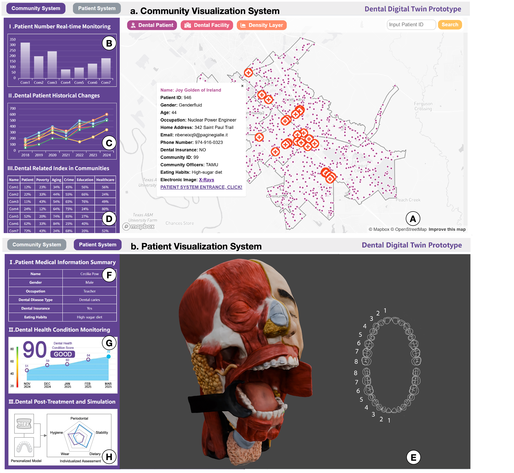

# Dental Digital Twin Prototype

A prototype of the Community–Patient multi-scale oral health visualization system.

Live demo: https://wangcheer97.github.io/dental-digital-twin/

## 3D model attribution

The 3D model used in the patient visualization interface was sourced from "Head and Neck Anatomy for Dentistry" by the University of Dundee, CAHID (https://sketchfab.com/anatomy_dundee), available at Sketchfab, licensed under CC BY 4.0 (https://creativecommons.org/licenses/by/4.0/).

## License

Source code: MIT. Map data © Mapbox © OpenStreetMap contributors. The anatomy model is CC BY 4.0 as stated above.

## Point heatmaps

The Community System toolbar offers Heatmap → Off / Patients / Facilities.
Patient locations are synthetic; facilities use the supplied 27 real point
geometries. All points have equal weight. These are Mapbox GL screen-space
heatmaps showing relative concentration, not exported fixed-bandwidth KDE
rasters or density per square kilometre. Radius varies with zoom (see
`js/community-map.js`); patient and facility intensity/radius settings differ,
so colors should not be compared quantitatively between the two datasets.
Smoothing may extend beyond service-area boundaries; no polygon clipping is
applied. Community fill is temporarily hidden while a heatmap is active, and
its previous visibility is restored on exit. Point overlays remain independent.

## Community count and socioeconomic maps

Density Map offers Patients and Facilities (counts per community, not counts
per km²). Patient counts are recalculated from the synthetic point coordinates on load;
facility counts use the point-in-polygon output. Socioeconomic Index Map offers
Income, Poverty, Aged 65+, Uninsured and SVI, all from the unrounded panel D CSV.
The synthetic Patient percentage is excluded. Each choropleth uses its own
observed seven-community minimum and maximum with a continuous color scale;
colors across different indicators do not share a numerical scale or imply a
common risk score. Sources, units and ranges appear in the legend. Income is
an approximation of community household median income; SVI remains a weighted
Texas tract rank. Density, heatmap and socioeconomic fills are mutually
exclusive; point and facility symbols remain independently controllable.

`python3 scripts/export_community_maps.py` regenerates
`data/community_map_data.js` from `output/community_indicators.csv` and canonical
Community1–7 polygons. The aggregation script now also invokes this export.

## Interface consistency (task 2)

`js/community-data.js` assigns synthetic patient points and facility points to
canonical Community1–7 polygons on load (ray casting with holes and boundary
handling). The resulting `COMMUNITY_STATS` feeds the bar chart, panel D patient
shares and map counts. Unassigned/ambiguous points are audited in the console.
The current counts are 324, 66, 245, 3, 48, 132, 182 (1,000 patients), and
9, 1, 6, 0, 0, 11, 0 (27 facilities). The historical line chart remains synthetic.
All public officer labels are TAMU. Browser patient popups also use the actual
spatial community assignment instead of legacy area IDs such as 99.

Percentages strictly between zero and one display as `<1%`; exact zero remains
`0%`. Com4 aged 65+ is exactly zero in the current weighted estimate; Com7 is
0.4585% and displays as `<1%`. This is a tract-based estimate, not a claim that
no older resident exists. The synthetic health panel is rendered from one
score series: 51, 59, 60, 64, 70; latest 70 = FAIR, on a 0–100 axis.
